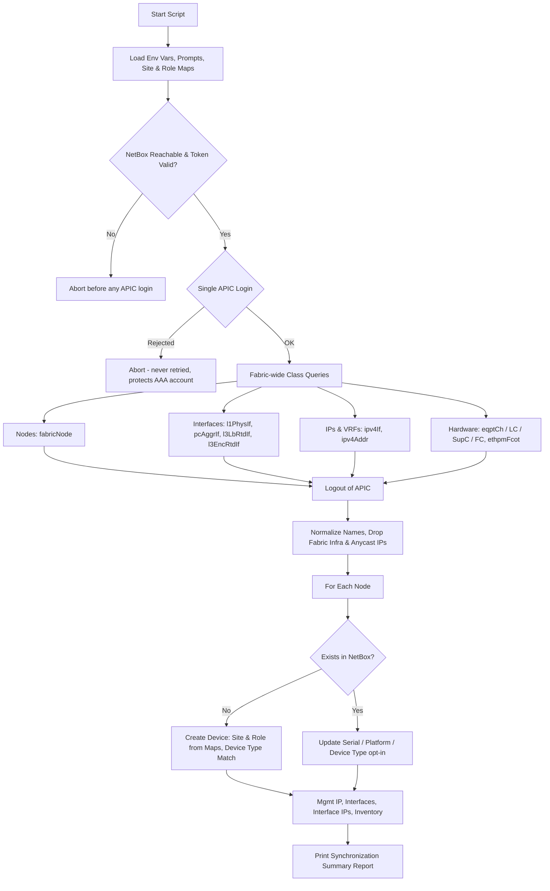

# Cisco ACI (APIC) to NetBox Synchronizer

## 1. What This Script Does

`aci_collector.py` is an automated discovery and synchronization tool for Cisco ACI fabrics. It reads the live state of every active leaf and spine from the APIC REST API and synchronizes it into NetBox, with NetBox as the source of truth.

It is the ACI companion to the [Cisco IOS / NX-OS to NetBox Synchronizer](https://github.com/NetWndrer/ios-nxos_netbox_importer) and follows the same conventions: interface naming, interface typing, device-type matching, IP handling, inventory, dry-run mode and summary report. NetBox data from both tools therefore looks consistent. The two scripts are independent: the IOS/NX-OS importer skips the `aci` platform, and this script only touches ACI fabric nodes.

Specifically, it automates the following tasks:
*   **Device Discovery:** Creates any fabric node (leaf or spine) that is missing from NetBox, choosing its site and role from simple mapping files.
*   **Device Serial Numbers & Platform:** Keeps the chassis serial number and the `aci` platform up to date.
*   **Device Type Reconciliation:** Matches the APIC hardware model (e.g. `N9K-C93180YC-FX3`) to the correct NetBox Device Type. It tries exact, normalized and fuzzy matches and refuses ambiguous ones. Overwriting an existing device's type is opt-in.
*   **Management IP:** Assigns the OOB (or in-band) management address to the management interface, infers the subnet mask from NetBox prefixes, and sets it as the device's primary IP.
*   **Interface Management:** Discovers physical ports, port-channels, loopbacks and L3Out routed subinterfaces. It creates missing interfaces and links subinterfaces to their parent port.
*   **Interface Enrichment:** Updates description, MTU, admin status and speed, and sets the NetBox interface type (e.g. `25gbase-x-sfp28`, `100gbase-x-cxp`, `400gbase-x-qsfpdd`) from the negotiated speed.
*   **IP Address Management (IPAM):** Syncs loopback and L3Out interface IPs.
*   **Hardware Inventory:** Records line cards, supervisors, fabric modules and transceivers (with part number and serial) as NetBox Inventory Items.

It deliberately **does not** import:
*   **Tenant SVI / bridge-domain gateway IPs.** In ACI the same anycast gateway IP exists on every leaf, so syncing it per leaf would create duplicate IPs.
*   **Fabric infrastructure plumbing:** TEP and anycast loopbacks, the routed leaf↔spine fabric subinterfaces, and the discovery subinterfaces APIC pre-builds on unused spine ports. All of these live in the infra VRF (`overlay-1`) and are managed entirely by APIC. You can opt in with `ACI_SYNC_INFRA=true`.

## 2. How It Works

The script runs as a single sequential pass and needs only one APIC login:

1.  **Pre-flight Checks:** It loads credentials and settings, then connects to NetBox and checks the URL and token *before* logging in to APIC. A bad NetBox setting therefore never costs an APIC login.
2.  **Single APIC Session:** It logs in to the APIC once. A rejected login is **never retried**, to protect your AAA account from lockout.
3.  **Fabric-wide Collection (REST API):** Instead of logging in to each switch, it runs a small number of fabric-wide APIC class queries, each covering every node at once:
    - nodes (`fabricNode`)
    - interfaces (`l1PhysIf`, `pcAggrIf`, `l3LbRtdIf`, `l3EncRtdIf`)
    - IPs and VRFs (`ipv4If`, `ipv4Addr`)
    - hardware (`eqptCh`, `eqptLC`, `eqptSupC`, `eqptFC`, `ethpmFcot`)

    Then it logs out. No SSH to switches is involved.
4.  **Normalization & Filtering:** It converts interface names to NetBox/NX-OS style (`eth1/1` → `Ethernet1/1`, `po1` → `Port-channel1`). It drops fabric infrastructure and anycast gateway IPs, and attaches optics and modules to their node.
5.  **Reconciliation & Sync:** For each node it compares the APIC data with NetBox and writes only the differences. Each update is isolated: a rejected change to one field or object doesn't block the others.
6.  **Report:** It prints a per-device summary table plus any non-fatal warnings.

### Architecture Workflow Diagram



## 3. Dependencies

You need Python 3.8+ and the following packages:

```bash
pip install pynetbox "requests>=2.27" urllib3
```

There is no Netmiko or TextFSM dependency: all data comes from the APIC REST API as JSON.

You also need:
*   **NetBox 4.x** (tested on 4.6) with an API token that can read and write devices, interfaces, inventory items and IP addresses. See the [Detailed Walkthrough](Detailed%20Walkthrough.md#netbox-requirements) for the full list.
*   **An APIC user with read-only access** (e.g. a `read-all` role on the `all` security domain). The script only issues GET class queries.

## 4. Modifying and Tuning for Your Environment

The script doesn't need to run on the NetBox server. It can run from any workstation or CI runner that has HTTPS access to both the APIC and NetBox.

### Quick Start

```bash
# 1. Tell the script which NetBox site and role each node belongs to
cp aci_site_map.example.json aci_site_map.json   # hostname pattern -> site slug
cp aci_role_map.example.json aci_role_map.json   # APIC role -> NetBox role slug(s)
# ...edit both files...

# 2. Preview one node first (nothing is written to NetBox)
python3 aci_collector.py --dry-run --node DC1-LEAF-101

# 3. Preview the whole fabric, then run for real
python3 aci_collector.py --dry-run
python3 aci_collector.py
```

### Configuration via Environment Variables

All prompts can be answered with environment variables instead, so the script can run unattended:

*   **`APIC_HOST`, `APIC_USER`, `APIC_PASS`**: APIC address and read-only credentials.
*   **`NETBOX_URL`, `NETBOX_TOKEN`**: NetBox URL (e.g. `https://netbox.example.com`; `https://` is assumed if you leave it off) and API token.
*   **`DRY_RUN`**: **Highly recommended for first runs.** Set to `"true"` to collect everything and log exactly what *would* change, without writing to NetBox.
*   **`OVERWRITE_DEVICE_TYPE`**: Set to `"true"` to let the APIC hardware model overwrite an existing device's Device Type in NetBox.
*   **`APIC_VERIFY_SSL` / `NETBOX_VERIFY_SSL`**: Set to `"true"` if the APIC or NetBox certificate is trusted. Both default to `"false"`, for self-signed certificates.

### Targeting Specific Nodes
*   `--node DC1-LEAF-101` (or `ACI_NODE`): sync a single fabric node, matched by exact name (case-insensitive).
*   `--role leaf` / `--role spine` (or `ACI_ROLE`): sync only leafs or only spines.

### Site and Role Mapping
These two small JSON files hold the environment-specific settings, so the script itself never contains your hostnames or site names. Both are listed in `.gitignore`.

*   **`aci_site_map.json`** maps a hostname substring to a NetBox site slug. It's only used when a *new* device has to be created; existing devices keep their NetBox site.
    ```json
    { "DC1-": "dc1", "DC2-": "dc2" }
    ```
*   **`aci_role_map.json`** maps an APIC role to one or more NetBox device role slugs. The **first** slug is used when creating a device. An existing device whose role is any slug in the list is left as-is.
    ```json
    { "leaf": ["dc-leaf", "dc-border-leaf"], "spine": ["dc-spine"] }
    ```

### Data Set Toggles
*   `ACI_SYNC_INTERFACES`, `ACI_SYNC_INTERFACE_IPS`, `ACI_SYNC_INVENTORY` (default `true`): turn off any data set you don't want.
*   `ACI_SYNC_INFRA` (default `false`): also import the fabric infrastructure loopbacks and subinterfaces, plus their `overlay-1` IPs.
*   `AUTO_CREATE_DEVICE_TYPES` (default `false`): create a missing Device Type instead of falling back to the `unknown-aci-switch` placeholder.

See the **[Detailed Walkthrough](Detailed%20Walkthrough.md)** for the full list of settings, NetBox prerequisites, the matching and filtering rules, sample output and troubleshooting.
